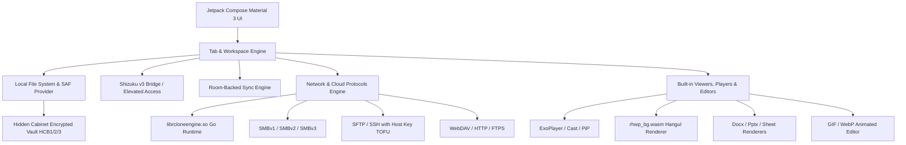
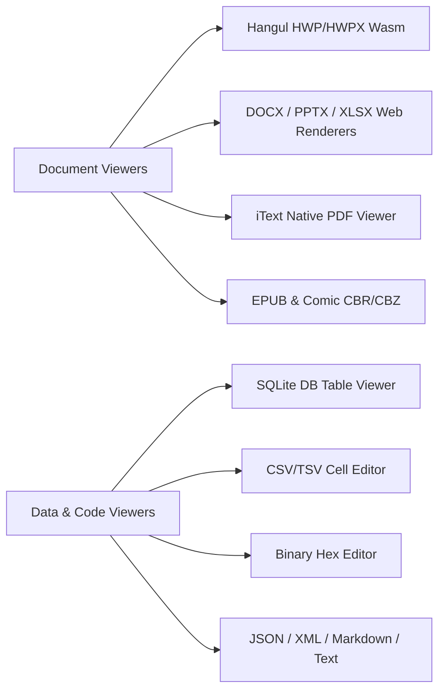
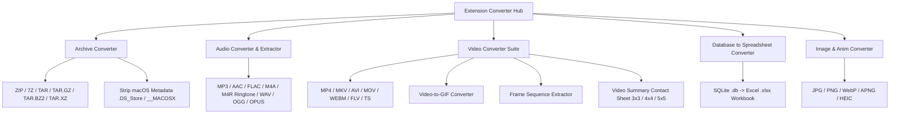

# File Manager Tab: Comprehensive Technical & Feature Analysis

> **Package Name:** `com.yeestudio.filemanager`  
> **App Version:** `1.10.19_PS` (`versionCode: 11019`)  
> **Target SDK:** 37 (Android 15+) | **Min SDK:** 32 (Android 12L+)  
> **Developer:** YeeStudio  
> **Analyzed Binary:** Extracted from device via ADB (Base APK + 4 Split APKs)

---

## 1. Executive Summary & Core Architecture

**File Manager Tab** is a high-performance, multi-tabbed file manager, network client, media suite, and productivity utility for Android. Unlike conventional mobile file explorers that operate within a single navigational stack, *File Manager Tab* is engineered around desktop-grade multitasking paradigms: browser-style tabs, custom tab workspaces, dual-pane splitting, and extensive protocol/format interoperability.

### Technical Stack & Architectural Layers
- **UI Framework:** Modern Android Jetpack Compose (`androidx.compose.material3: 1.4.0`) layered over Material 3 design specifications with dynamic theming.
- **Concurrency & Asynchrony:** Kotlin Coroutines (`kotlinx-coroutines: 1.11.0`) with Kotlin Flow pipelines for reactive UI updates and file system events.
- **Persistence & Databases:** 
  - AndroidX Room (`2.8.5`) backing complex relational datasets (Sync plans, jobs, leases, baselines, deletion attestations, playlists, playback history, and upload queues).
  - AndroidX DataStore Preferences (`1.3.0`) for real-time tab state, user preferences, and workspace metadata.
- **Native Interoperability (NDK / JNI):**
  - `librcloneengine.so` (37.6 MB) & `librclonejni.so`: Embedded Go 1.27 runtime hosting the full **rclone** file synchronization engine.
  - `libunrarjni.so`: Native C/C++ RAR decompression backend.
  - `libglide-webp.so`: WebP hardware/software image decoding pipeline.
- **Document Rendering Engines:**
  - `rhwp_bg.wasm` (11.8 MB WebAssembly) + `rhwp.js`: WebAssembly-compiled South Korean Hangul Word Processor (HWP/HWPX) rendering engine.
  - Headless WebView-backed Office suite utilizing `docx-preview`, `aiden0z-pptx-renderer`, `echarts`, `zrender`, and `rtf.js`.
- **System Privileges & SAF:**
  - Android Storage Access Framework (SAF) `DocumentsProvider` (`RemoteDocumentsProvider`, `StreamContentProvider`).
  - Shizuku API v3 (`moe.shizuku.manager.permission.API_V23`) for elevated rootless access to restricted Android 11+ storage directories (`/Android/data`, `/Android/obb`).

---

## 2. Tabbed Browsing & Workspace Management

### Multi-Tab System
- **Browser-Style Tabs:** Allows opening arbitrary paths (internal storage, SD card, OTG, SMB shares, SFTP, WebDAV, Cloud folders, Trash, and search results) in independent parallel tabs.
- **Tab Controls:** Individual close buttons, drag-and-drop reordering knobs, and a persistent `New Tab` (`+`) action.
- **State Preservation:** Tab scroll positions, selections, and navigational breadcrumbs are persisted across app restarts via DataStore.

### Workspace Persistence
- **Custom Workspaces:** Users can bundle active sets of tabs into named "Workspaces" (e.g., `Work`, `Media`, `Backup`, `Cloud Sync`).
- **Workspace Switching:** Switch between workspaces via the slide-out navigation drawer with zero state loss.
- **Sheet Management:** Add, rename, reorder, or delete workspace configurations.

### Navigation Drawer & Quick Navigation
- **History:** Chronological log of visited file paths.
- **Bookmarks & Custom Folders:** Hierarchical bookmark manager allowing custom bookmark groups.
- **Current Location Tree:** Instant overview of mounted storage volumes, remaining capacity, and shortcut destinations.
- **Go To Path:** Direct path entry modal with auto-completion.

---

## 3. Network & Cloud Storage Capabilities

The app features an enterprise-grade cloud and remote protocol implementation powered by a hybrid architecture of native Java/Kotlin protocol stacks and an embedded **rclone** Go engine.

### Remote Network Protocols
| Protocol | Versions / Security | Key Technical Features |
| :--- | :--- | :--- |
| **SMB / CIFS** | SMBv1, SMBv2, SMBv3 | Network broadcast scanning, automatic dialect negotiation, domain authentication, direct media streaming without pre-downloading. |
| **SFTP (SSH)** | SSH-2 | Custom SSH port, password & private key authentication, Trust-On-First-Use (TOFU) host key verification, key fingerprint change alerts. |
| **FTP / FTPS** | Plain FTP, Explicit TLS, Implicit TLS | Active and Passive data transfer modes, custom character encoding selector (UTF-8, ISO-8859-1, GBK). |
| **WebDAV** | HTTP / HTTPS | Custom port, SSL/TLS certificate viewer and validation, certificate pinning/override, automatic chunking/split uploads. |
| **NFS** | Network File System | Integration hooks for Unix/NAS network shares. |

### Supported Cloud Providers
1. **Google Drive:** Full OAuth2 integration, shared drives, Google Workspace shortcuts, and granular scope management.
2. **Microsoft OneDrive:** Personal and Business (Office 365 / MSAL) authentication.
3. **Dropbox:** Official API integration with OAuth token exchange and network resilience handling.
4. **Box:** Dedicated authentication activity (`BoxAuthActivity`) with token refresh mechanisms.
5. **MEGA:** Dedicated login flow supporting multi-factor authentication (MFA / 2FA) and cryptographic session keys.
6. **Nextcloud / ownCloud:** Dedicated Nextcloud onboarding wizard with auto-detection of WebDAV endpoints.
7. **Yandex Disk:** Dedicated OAuth flow (`YandexAuthActivity`).
8. **Amazon S3 & S3-Compatible Cloud:**
   - Supports Amazon AWS S3 and any S3-compliant provider (Cloudflare R2, Backblaze B2, Wasabi, MinIO, DigitalOcean Spaces, Ceph).
   - Parameters: Access Key ID, Secret Access Key, Session Token, Custom Endpoint URL, Region, Bucket Name, Path Prefix, and Path-Style vs. Virtual-Hosted Style addressing.
   - S3 Versioning: View historical object versions, restore previous revisions, and access S3 bucket trash.
9. **Backblaze B2:** Direct B2 native backend support via rclone integration.

### Storage Access Framework (SAF) Provider
- Implements `RemoteDocumentsProvider`: Exposes connected SMB, SFTP, and Cloud storage directly to the Android OS file picker. Other installed Android apps can open or save files directly to remote network shares.

---

## 4. Local File Management & Elevated Privileges

### Storage Volumes & Categories
- **Internal Storage (Main Storage):** Direct access to user internal storage (`/sdcard` / `/storage/emulated/0`).
- **External Storage / USB OTG:** Auto-mounting and notification detection for SD cards and USB drives.
- **System Root Explorer:** Full root navigation (`/`) when root access (Magisk / KernelSU / APatch) is present.
- **Dual Storage / Multiple Users:** Browsing secondary Android profiles, Work Profiles, and Dual Messenger storage spaces.

### Shizuku Elevated Storage Access
- Implements `moe.shizuku.manager.permission.API_V23`.
- Android 11+ enforces Scoped Storage, blocking conventional file managers from `/Android/data` and `/Android/obb`.
- Through Shizuku (ADB wireless debugging service), *File Manager Tab* performs high-speed reading, writing, moving, and extracting directly inside `/Android/data` without needing device root.

### Recycle Bin / Trash
- Soft-delete protection across local file systems.
- Stored in a sandboxed Trash folder with original path metadata, allowing one-click file restoration or secure permanent destruction.

---

## 5. Built-in Document, Code & Data Viewers

*File Manager Tab* integrates a comprehensive standalone viewing suite, removing the need for external third-party viewer apps.

### Document Viewers
1. **Hangul Word Processor (HWP / HWPX / OWPML):**
   - High-fidelity South Korean national document standard reader.
   - Powered by WebAssembly (`rhwp_bg.wasm` + `rhwp.js`).
   - Supports tables, formatted paragraphs, embedded vector/raster graphics, search within document, and text preview fallback.
2. **Microsoft Office Suite:**
   - **Word (`.docx`, `.doc`, `.rtf`):** Document layout, font mapping, tables, and images.
   - **Excel (`.xlsx`, `.xls`):** Multi-sheet tabs, column widths, formula results, and grid lines.
   - **PowerPoint (`.pptx`, `.ppt`):** Slide preview, text formatting, and graphic shapes via `aiden0z-pptx-renderer`.
3. **PDF Viewer:**
   - Fast page-by-page rendering, zoom controls, text selection, page jump, and PDF export/share.
4. **E-Books & Comics:**
   - **EPUB:** Clean reflowable text reader with chapters and bookmarks.
   - **CBR & CBZ:** Comic book archive reader with horizontal/vertical paging.

### Code, Data & Low-Level Viewers
1. **SQLite Database Viewer & Editor (`db_viewer`):**
   - Direct inspection of SQLite database files (`.db`, `.sqlite`, `.sqlite3`).
   - Table schema inspection, row browsing, column sorting, and custom SQL query execution.
2. **CSV / TSV Spreadsheet Viewer & Editor:**
   - Full tabular grid with editable cells, header recognition, and instant delimiter adjustments.
3. **Hex Viewer / Editor (`hex_viewer`):**
   - Byte-level hexadecimal and ASCII side-by-side inspection for binary analysis.
4. **JSON Viewer:**
   - Interactive collapsible tree view, node search, syntax error indicator with line/offset highlighting.
5. **Markdown Viewer:**
   - Formatted GitHub-flavored markdown rendering with code blocks and table support.
6. **Text Editor:**
   - Line numbering, search & replace, word wrap toggle, and encoding conversion (UTF-8, UTF-16, ISO-8859-1, EUC-KR, Shift-JIS, GB2312, Big5).
7. **Font Viewer:**
   - Interactive typography preview for TrueType (`.ttf`) and OpenType (`.otf`) fonts across multiple sizes and weights.

---

## 6. Multimedia Suite: Players & Editors

### Advanced Video Player
- **Playback Core:** Hardware-accelerated ExoPlayer engine supporting 4K HDR, HEVC/H.265, AV1, VP9, H.264, MKV, MP4, AVI, MOV, TS.
- **Network Streaming:** Direct on-the-fly streaming from SMB, SFTP, WebDAV, FTP, Google Drive, and OneDrive (`NetworkVideoPlaybackService`).
- **Floating Picture-in-Picture (PiP):** Multitask with video playback floating above any Android app.
- **Subtitle Synchronizer & Styler:**
  - Embedded subtitles and external subtitle tracks (`.srt`, `.vtt`, `.ass`, `.ssa`).
  - Online subtitle search & auto-discovery.
  - Subtitle delay/advance synchronization slider with microsecond accuracy.
  - Subtitle customization: text color, border/shadow edges, size, opacity, and background box.
- **Google Cast / Chromecast:** Full Cast SDK integration (`CastSessionService`) to beam local or remote network media directly to Smart TVs.
- **Video Wallpaper:** Set any video file directly as the Android device's live wallpaper (`VideoWallpaperService`).

### Audio & Music Player
- **Foreground Music Service:** Background audio playback (`AudioPlaybackService`) with lock screen controls, lock screen album art, and notification media controls.
- **Playlists:** Create, save, and export custom audio playlists backed by Room database entities (`playlists`, `playlist_items`).
- **Audio Controls:** Shuffle, repeat (all, track, off), playback speed tuning, and ID3 tag reader.

### Animated Image Editor (GIF & Animated WebP)
A comprehensive built-in frame-by-frame animation studio:
- **Timeline & Frame Management:** Visual multi-frame timeline; select individual frames, multi-select, duplicate, reorder, delete, or insert new frames.
- **Speed & Duration Control:** Global or per-frame timing adjustments with speed presets.
- **Cropping & Sizing:** Freeform, 1:1 Square, 16:9 Landscape, and 9:16 Portrait cropping.
- **Drawing & Annotation:** Draw directly onto individual frames or batch-apply annotations across all frames.
- **Palette & Color Quantization:** Color limiter presets (32, 64, 128 colors, or Full 256 colors) for GIF file size optimization.
- **Frame Extraction:** Extract all frames to PNG, JPG, or WebP with automated sequential naming rules.
- **Loop Settings:** Infinite loop, play once, or play 3 times.

---

## 7. Media & Archive Conversion Utilities ("Extension Converter")

The "Extension Converter" hub provides full multi-format batch conversion capabilities:

1. **Archive Converter:**
   - Convert between archive containers (ZIP, 7Z, TAR, TAR.GZ, TAR.BZ2, TAR.XZ).
   - Sanitize archives by automatically stripping macOS metadata artifacts (`.DS_Store`, `__MACOSX`).
   - Add files directly into existing archives without full extraction.
   - Password encryption support for ZIP.
2. **Audio Converter & Extractor:**
   - Convert between audio formats: MP3, AAC, FLAC, M4A, M4R (iPhone Ringtone), WAV, OGG, OPUS, AMR, 3GP, WEBM.
   - Extract audio tracks directly from video files.
3. **Video Converter Suite:**
   - Batch video transcoding between MP4, MKV, AVI, MOV, WEBM, FLV, TS, and 3GP.
   - **Video to GIF:** Convert video segments into animated GIFs with customizable start/end points, duration, and FPS.
   - **Video Frame Sequence Extractor:** Extract keyframes at 1s, 3s, or 5s intervals.
   - **Video Summary Contact Sheet:** Generate visual video summary grids (3x3, 4x4, 5x5) displaying timestamps.
4. **Database to Spreadsheet Converter:**
   - Converts SQLite databases (`.db`, `.sqlite`) into multi-tab Microsoft Excel (`.xlsx`) workbooks.
5. **Animated Image Converter:**
   - Converts animated GIF files to optimized WebP or APNG.

---

## 8. Automated File Synchronization Engine

The app contains an enterprise-grade automated sync engine managed by `SyncManualService` and `SyncUserTransferJobService`, utilizing Room tables (`sync_jobs`, `sync_plans`, `sync_runs`, `sync_operations`, `sync_baselines`, `sync_leases`):

- **Sync Directions:**
  - One-Way Sync (Local -> Remote / A -> B)
  - One-Way Mirror (Remote -> Local / B -> A)
  - Two-Way Bidirectional Sync
- **Execution Triggers:**
  - Manual execution
  - Automated recurring schedule
  - Network constraints (Wi-Fi only, non-metered connections)
  - Power constraints (Charging only, Battery not low)
- **Conflict & Deletion Protection:**
  - Conflict resolution policies (Prompt user, keep newest, keep largest, overwrite).
  - Deletion verification (`sync_deletion_approvals`, `sync_deletion_authorizations`) to prevent accidental mass deletions.
  - Baselines tracking to compute exact diffs between sync cycles.

---

## 9. Built-in Network File Servers (PC Wireless File Sharing)

Allows zero-cable bidirectional file management between computers, tablets, and phones over local Wi-Fi:

### 1. HTTP Web Server (`HttpServerService`)
- Hosts a complete embedded web browser file manager (`assets/http/file-browser.html`).
- Any device on the same local network can access, browse, upload, download, and delete files using standard desktop web browsers (Chrome, Firefox, Safari, Edge).
- QR code display for instant mobile/desktop camera pairing.
- Configurable listening port and download permissions for Hidden Cabinet content.
- Dedicated Quick Settings Tile (`HttpServerTileService`).

### 2. FTP Server (`FtpServerService`)
- Standard FTP/FTPS server for mounting the phone as a network drive in Windows File Explorer, macOS Finder, or Cyberduck/FileZilla.
- Configurable port, custom root path, and authentication modes (Anonymous vs. Username/Password with random password generator).
- Dedicated Quick Settings Tile (`FtpServerTileService`).

---

## 10. Web Clips & Real-Time Media Stream Recorder

An advanced web archiving and multimedia acquisition suite:

### 1. Web Page Archiving ("Web Clips")
- Save web pages offline into multiple formats: **Full HTML**, **MHTML**, **Markdown**, **PDF**, or **Clean Text**.
- Structured media assets extraction: downloads embedded images and videos into clean local folders (`images/`, `videos/`).
- Interactive headless WebView integration: handles pages requiring manual login, CAPTCHA completion, or client-side JavaScript execution.
- Image filter controls: filter by dimensions, ignore external CDN tracking pixels, lossy image deduplication.

### 2. Real-Time Stream Recorder
- Sniffs and records live media streams directly to MP4 or audio files.
- Protocols supported: **HLS (`.m3u8`)**, **DASH (`.mpd`)**, and direct HTTP streaming media.
- Real-time download metrics: displays live bitrate (kbps/mbps), average download speed, elapsed time, and segment acquisition progress.
- Subtitle extraction and background queue management.

---

## 11. Security, App Lock & "Hidden Cabinet"

### Hidden Cabinet Encrypted Vault
- Encrypted storage container system utilizing proprietary high-security container versions: `hcb1`, `hcb2`, and `hcb3`.
- Files moved to Hidden Cabinet are encrypted, shielded from Android's MediaStore indexer (`.nomedia`), and hidden from gallery/photo apps.
- Experimental direct video playback within the encrypted container without decrypting the entire file to disk first.
- Complete vault export and import workflows with password validation.

### App Lock & Authentication
- Biometric authentication (`USE_BIOMETRIC`, `USE_FINGERPRINT` via `androidx.biometric`).
- Alternative authentication: PIN, Password, Pattern.
- Granular lock options: protect the entire application or restrict lock exclusively to the Hidden Cabinet.

---

## 12. Storage Analysis, App Manager & Specialized Tools

### Storage Analysis
- Visual disk breakdown (used vs. free storage).
- **Duplicate Files Finder:** Scans file content hashes to identify identical redundant files.
- **Large Files Finder:** Filters files over customizable size thresholds.
- **Junk & Cache Cleaner:** Detects leftover app caches, temporary files, and empty directory trees.
- **App Storage Inspector:** Analyzes space occupied by installed applications and their data.

### App Manager ("Apps")
- List installed user applications and system applications.
- **APK & APKS Split Backup:** Back up installed apps into standalone `.apk` or bundle `.apks` archives.
- Uninstaller, App Details inspector, and quick launch shortcuts.

### Dedicated Minecraft Bedrock Manager
A built-in management console specifically tailored for Minecraft Bedrock Edition (`com.mojang.minecraftpe`):
- Filter and manage Minecraft **Worlds**, **Resource Packs**, **Behavior Packs**, **Add-ons**, **Structures**, **Templates**, and **Projects**.
- One-click import, export, and backup of Minecraft worlds and custom packs.

### Android System Widgets & Quick Settings Tiles
- **Homescreen Widgets:**
  1. `StorageWidgetProvider`: Real-time storage consumption gauge.
  2. `QuickAccessWidgetProvider`: Instant shortcuts to user folders.
  3. `FavoritesWidgetProvider`: Pinned bookmarks widget.
  4. `RecentFilesWidgetProvider`: Dynamic list of recently modified files.
- **Quick Settings Tiles:**
  1. `FtpServerTileService`: One-tap FTP toggle in the Android system shade.
  2. `HttpServerTileService`: One-tap HTTP Web Server toggle.
  3. `StorageAnalysisTileService`: Launch storage analyzer from the shade.
  4. `NewFilesTileService`: Instant access to recently downloaded/received files.

---

## 13. Summary Matrix of All App Capabilities

| Category | Features & Technical Highlights |
| :--- | :--- |
| **Tabbed Interface** | Multiple tabs, tab reordering, close tab, tab persistence, named Workspaces. |
| **Storage Protocols** | SMB (v1/v2/v3), SFTP (SSH), FTP, FTPS, WebDAV, NFS, SAF Remote Documents Provider. |
| **Cloud Backends** | Google Drive, OneDrive (Personal/Business), Dropbox, Box, MEGA (2FA), Nextcloud, Yandex Disk, Amazon S3, Backblaze B2 via rclone. |
| **System Access** | Internal Storage, SD Card, USB OTG, Dual Profiles, Root (`/`), Shizuku v3 (`/Android/data` rootless). |
| **Document Viewers** | Hangul HWP/HWPX (Wasm), Office (DOCX, XLSX, PPTX, RTF), PDF, EPUB, Comic CBR/CBZ. |
| **Code / Data Viewers** | SQLite DB Viewer/Editor, CSV Editor, Hex Viewer, JSON Tree, Markdown, XML, Multi-encoding Text Editor, Font Viewer. |
| **Media Players** | ExoPlayer 4K HDR, Picture-in-Picture, Background Audio, Network Streaming, Subtitle Sync, Chromecast, Live Video Wallpaper. |
| **Animated Image Editor** | Frame-by-frame GIF/WebP editor, timeline, crop, frame speed, palette reducer (32-256), annotations, frame extractor. |
| **File Converters** | Archive Converter (ZIP/7Z/TAR with Mac metadata strip), Audio Converter & Extractor, Video Converter, Video-to-GIF, Video Frame Extractor, Video Summary Contact Sheet, DB-to-Excel Converter. |
| **File Sync Engine** | One-way & Two-way automated sync, scheduled jobs, charging/Wi-Fi constraints, conflict resolution, deletion approvals. |
| **Wireless PC Sharing** | HTTP Web Server with browser UI & QR code; FTP/FTPS Server; Quick Settings Tiles. |
| **Web Archiving** | Web Clips (HTML/MHTML/Markdown/PDF/Text), media scrapers, live stream HLS/DASH real-time recorder. |
| **Security & Privacy** | Hidden Cabinet (Encrypted Vault `hcb1`/`hcb2`/`hcb3`), App Lock (Biometrics/PIN/Password/Pattern), Vault Export/Import. |
| **Storage Cleaner** | Duplicate file finder (hash-based), large file finder, junk/cache cleaner, empty folder cleaner. |
| **Specialized Tools** | App Manager & APK/APKS Split Extractor; Minecraft Bedrock Worlds/Add-ons Manager. |
